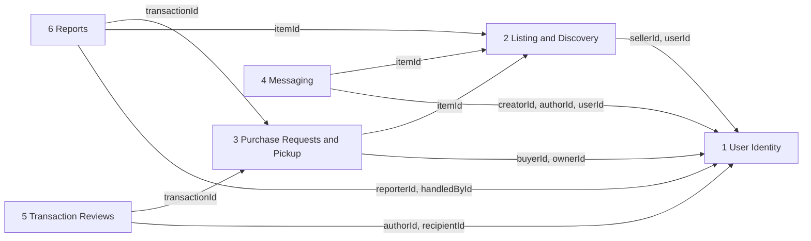
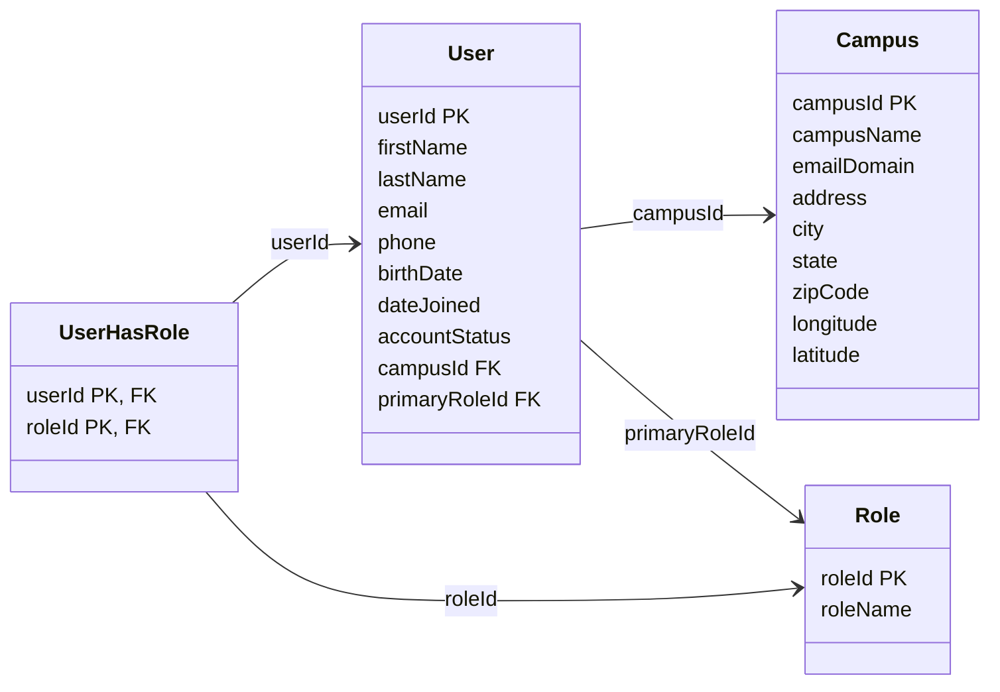
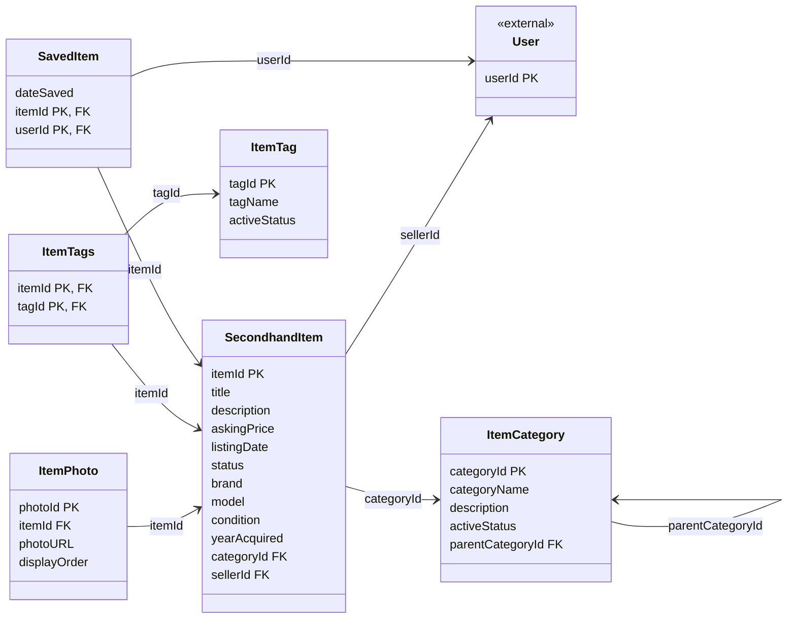
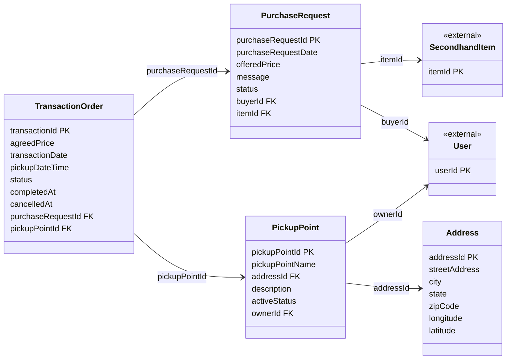
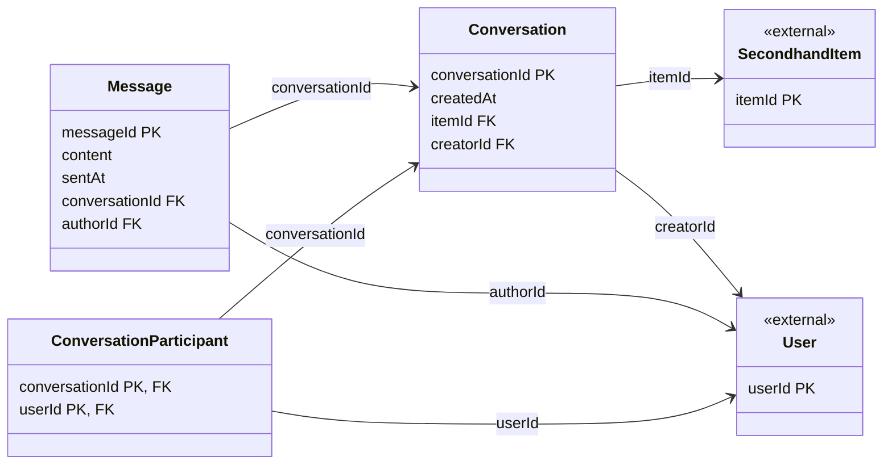
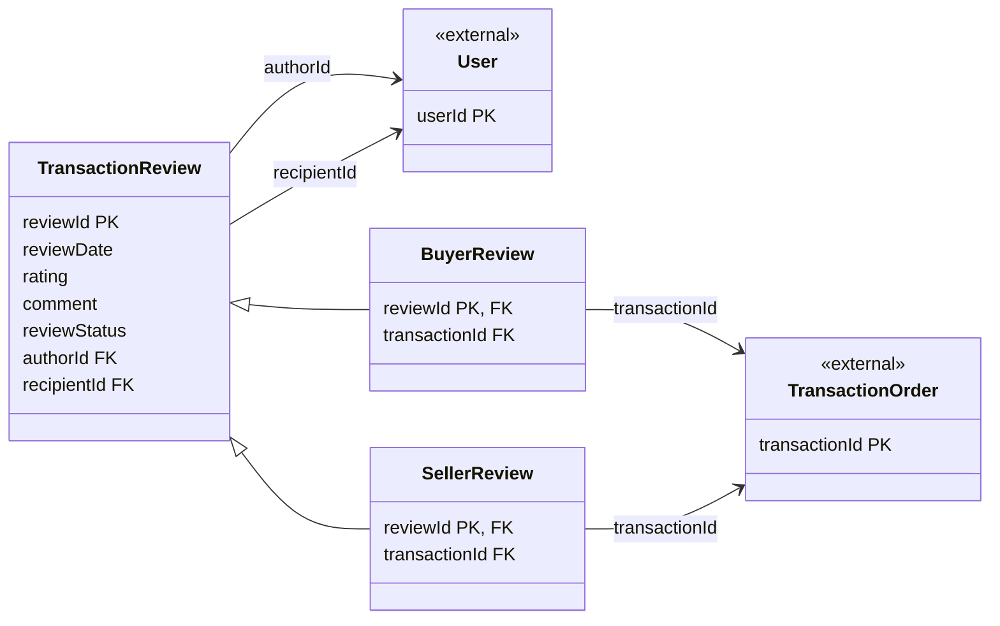
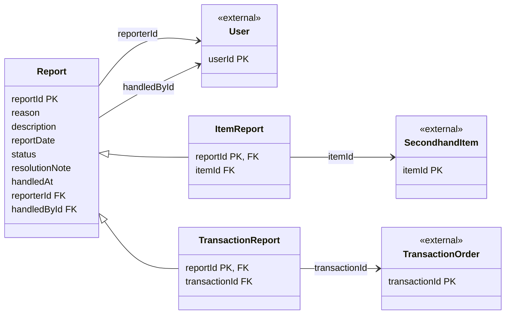

# Relational Model

This document gives the relational models of the campus secondhand marketplace, derived from the project's UML class diagrams, with a data type for every attribute and the extra attributes that the project's use cases need. It is organised by subsystem, in six sections, and each section can be read on its own.

## Subsystem Map

| Section | Relations |
| --- | --- |
| [1 User Identity](#1-user-identity) | Campus, User, Role, UserHasRole |
| [2 Listing and Discovery](#2-listing-and-discovery) | ItemCategory, SecondhandItem, ItemPhoto, ItemTag, ItemTags, SavedItem |
| [3 Purchase Requests and Pickup](#3-purchase-requests-and-pickup) | PurchaseRequest, Address, PickupPoint, TransactionOrder |
| [4 Messaging](#4-messaging) | Conversation, Message, ConversationParticipant |
| [5 Transaction Reviews](#5-transaction-reviews) | TransactionReview, BuyerReview, SellerReview |
| [6 Reports](#6-reports) | Report, ItemReport, TransactionReport |

The diagram below shows only the foreign keys that cross a section boundary. An arrow points from the section that holds the foreign key to the section it references, and the label lists the foreign-key attributes.

## Reading Conventions

Each section opens with a Mermaid class diagram of its relations. Below the diagram, every relation has its own table, and each row of that table is one attribute. Within a section, a relation is listed after the relations it references wherever the references allow it.

- Each relation is drawn as a class. `PK` and `FK` mark primary-key and foreign-key attributes.
- An arrow points from the relation that holds a foreign key to the relation it references, and the arrow label is the foreign-key attribute.
- A class marked `<<external>>` is defined in another section and appears only so that its foreign keys resolve. It shows only its primary key.

The columns of each attribute table are:

- **Attribute:** the attribute name.
- **Type:** `int` for identifiers, `number` for every other number (prices, coordinates, rating, display order, year), `string` for text, `boolean` for flags, `date` for calendar dates, and `timestamp` for points in time. A foreign key has the type of the attribute it references. These types are generic; the exact SQL types and lengths are chosen later together with the DBMS.
- **Key:** `PK`, `FK`, or both. A composite primary key is also stated above its table.
- **Nullability:** `NOT NULL`, or `NULL` where the attribute may be empty, with the reason in brackets. A primary-key attribute is NOT NULL because of the key.
- **Domain / CHECK:** value ranges, the allowed values of a status or similar attribute, and comparisons with another attribute.
- **References:** the relation and attribute that a foreign key points to.

A dash means that no constraint is stated for that cell.

## 1 User Identity

Campuses, users, and the roles that users hold.

### Campus

| Attribute | Type | Key | Nullability | Domain / CHECK | References |
| --- | --- | --- | --- | --- | --- |
| campusId | int | PK | NOT NULL | — | — |
| campusName | string | — | NOT NULL | — | — |
| emailDomain | string | — | NOT NULL | — | — |
| address | string | — | — | — | — |
| city | string | — | — | — | — |
| state | string | — | — | — | — |
| zipCode | string | — | — | — | — |
| longitude | number | — | — | between -180 and 180 | — |
| latitude | number | — | — | between -90 and 90 | — |

### User

| Attribute | Type | Key | Nullability | Domain / CHECK | References |
| --- | --- | --- | --- | --- | --- |
| userId | int | PK | NOT NULL | — | — |
| firstName | string | — | — | — | — |
| lastName | string | — | — | — | — |
| email | string | — | NOT NULL | — | — |
| phone | string | — | — | — | — |
| birthDate | date | — | — | — | — |
| dateJoined | date | — | — | — | — |
| accountStatus | string | — | NOT NULL | `IN ('ACTIVE', 'SUSPENDED')` | — |
| campusId | int | FK | NOT NULL | — | → Campus(campusId) |
| primaryRoleId | int | FK | NOT NULL | — | → Role(roleId) |

### Role

| Attribute | Type | Key | Nullability | Domain / CHECK | References |
| --- | --- | --- | --- | --- | --- |
| roleId | int | PK | NOT NULL | — | — |
| roleName | string | — | NOT NULL | — | — |

### UserHasRole

Composite primary key: (userId, roleId)

| Attribute | Type | Key | Nullability | Domain / CHECK | References |
| --- | --- | --- | --- | --- | --- |
| userId | int | PK, FK | NOT NULL | — | → User(userId) |
| roleId | int | PK, FK | NOT NULL | — | → Role(roleId) |

## 2 Listing and Discovery

Categories, tags, items, item photos, and the items that users save.

### ItemCategory

| Attribute | Type | Key | Nullability | Domain / CHECK | References |
| --- | --- | --- | --- | --- | --- |
| categoryId | int | PK | NOT NULL | — | — |
| categoryName | string | — | NOT NULL | — | — |
| description | string | — | — | — | — |
| activeStatus | boolean | — | — | — | — |
| parentCategoryId | int | FK | NULL (topmost category) | — | → ItemCategory(categoryId) |

### SecondhandItem

| Attribute | Type | Key | Nullability | Domain / CHECK | References |
| --- | --- | --- | --- | --- | --- |
| itemId | int | PK | NOT NULL | — | — |
| title | string | — | — | — | — |
| description | string | — | — | — | — |
| askingPrice | number | — | — | >= 0 | — |
| listingDate | date | — | — | — | — |
| status | string | — | — | `IN ('AVAILABLE', 'RESERVED', 'SOLD', 'REMOVED')` | — |
| brand | string | — | — | — | — |
| model | string | — | — | — | — |
| condition | string | — | — | `IN ('NEW', 'LIKE_NEW', 'GOOD', 'FAIR', 'POOR')` | — |
| yearAcquired | number | — | — | — | — |
| categoryId | int | FK | NOT NULL | — | → ItemCategory(categoryId) |
| sellerId | int | FK | NOT NULL | — | → User(userId) |

### ItemPhoto

| Attribute | Type | Key | Nullability | Domain / CHECK | References |
| --- | --- | --- | --- | --- | --- |
| photoId | int | PK | NOT NULL | — | — |
| itemId | int | FK | NOT NULL | — | → SecondhandItem(itemId) |
| photoURL | string | — | NOT NULL | — | — |
| displayOrder | number | — | NOT NULL | >= 1 | — |

### ItemTag

| Attribute | Type | Key | Nullability | Domain / CHECK | References |
| --- | --- | --- | --- | --- | --- |
| tagId | int | PK | NOT NULL | — | — |
| tagName | string | — | NOT NULL | — | — |
| activeStatus | boolean | — | — | — | — |

### ItemTags

Composite primary key: (itemId, tagId)

| Attribute | Type | Key | Nullability | Domain / CHECK | References |
| --- | --- | --- | --- | --- | --- |
| itemId | int | PK, FK | NOT NULL | — | → SecondhandItem(itemId) |
| tagId | int | PK, FK | NOT NULL | — | → ItemTag(tagId) |

### SavedItem

Composite primary key: (itemId, userId)

| Attribute | Type | Key | Nullability | Domain / CHECK | References |
| --- | --- | --- | --- | --- | --- |
| dateSaved | date | — | NOT NULL | — | — |
| itemId | int | PK, FK | NOT NULL | — | → SecondhandItem(itemId) |
| userId | int | PK, FK | NOT NULL | — | → User(userId) |

## 3 Purchase Requests and Pickup

A buyer's request for an item, the pickup point and its address, and the order that a request can become.

### PurchaseRequest

| Attribute | Type | Key | Nullability | Domain / CHECK | References |
| --- | --- | --- | --- | --- | --- |
| purchaseRequestId | int | PK | NOT NULL | — | — |
| purchaseRequestDate | date | — | — | — | — |
| offeredPrice | number | — | — | >= 0 | — |
| message | string | — | — | — | — |
| status | string | — | — | `IN ('PENDING', 'ACCEPTED', 'REJECTED')` | — |
| buyerId | int | FK | NOT NULL | — | → User(userId) |
| itemId | int | FK | NOT NULL | — | → SecondhandItem(itemId) |

### Address

| Attribute | Type | Key | Nullability | Domain / CHECK | References |
| --- | --- | --- | --- | --- | --- |
| addressId | int | PK | NOT NULL | — | — |
| streetAddress | string | — | NOT NULL | — | — |
| city | string | — | NOT NULL | — | — |
| state | string | — | NOT NULL | — | — |
| zipCode | string | — | NOT NULL | — | — |
| longitude | number | — | — | between -180 and 180 | — |
| latitude | number | — | — | between -90 and 90 | — |

### PickupPoint

| Attribute | Type | Key | Nullability | Domain / CHECK | References |
| --- | --- | --- | --- | --- | --- |
| pickupPointId | int | PK | NOT NULL | — | — |
| pickupPointName | string | — | NOT NULL | — | — |
| addressId | int | FK | NOT NULL | — | → Address(addressId) |
| description | string | — | — | — | — |
| activeStatus | boolean | — | — | — | — |
| ownerId | int | FK | NOT NULL | — | → User(userId) |

### TransactionOrder

| Attribute | Type | Key | Nullability | Domain / CHECK | References |
| --- | --- | --- | --- | --- | --- |
| transactionId | int | PK | NOT NULL | — | — |
| agreedPrice | number | — | — | >= 0 | — |
| transactionDate | date | — | — | — | — |
| pickupDateTime | timestamp | — | — | — | — |
| status | string | — | — | `IN ('PENDING', 'COMPLETED', 'CANCELLED')` | — |
| completedAt | timestamp | — | NULL (until completed) | — | — |
| cancelledAt | timestamp | — | NULL (unless cancelled) | — | — |
| purchaseRequestId | int | FK | NOT NULL | — | → PurchaseRequest(purchaseRequestId) |
| pickupPointId | int | FK | NOT NULL | — | → PickupPoint(pickupPointId) |

## 4 Messaging

Conversations about an item, the users taking part, and the messages they send.

**Note on `Conversation`:** each Conversation must contain at least one Message, and creatorId guarantees at least one participant.

### Conversation

| Attribute | Type | Key | Nullability | Domain / CHECK | References |
| --- | --- | --- | --- | --- | --- |
| conversationId | int | PK | NOT NULL | — | — |
| createdAt | timestamp | — | — | — | — |
| itemId | int | FK | NOT NULL | — | → SecondhandItem(itemId) |
| creatorId | int | FK | NOT NULL | — | → User(userId) |

### Message

| Attribute | Type | Key | Nullability | Domain / CHECK | References |
| --- | --- | --- | --- | --- | --- |
| messageId | int | PK | NOT NULL | — | — |
| content | string | — | — | — | — |
| sentAt | timestamp | — | — | — | — |
| conversationId | int | FK | NOT NULL | — | → Conversation(conversationId) |
| authorId | int | FK | NOT NULL | — | → User(userId) |

### ConversationParticipant

Composite primary key: (conversationId, userId)

| Attribute | Type | Key | Nullability | Domain / CHECK | References |
| --- | --- | --- | --- | --- | --- |
| conversationId | int | PK, FK | NOT NULL | — | → Conversation(conversationId) |
| userId | int | PK, FK | NOT NULL | — | → User(userId) |

## 5 Transaction Reviews

A review that one user writes about another, as a buyer review or a seller review of an order.

**Note on `TransactionReview`:** BuyerReview and SellerReview are disjoint subtypes, so a review is never both.

### TransactionReview

| Attribute | Type | Key | Nullability | Domain / CHECK | References |
| --- | --- | --- | --- | --- | --- |
| reviewId | int | PK | NOT NULL | — | — |
| reviewDate | date | — | — | — | — |
| rating | number | — | — | between 1 and 5 | — |
| comment | string | — | — | — | — |
| reviewStatus | string | — | — | — | — |
| authorId | int | FK | NOT NULL | `<>` recipientId | → User(userId) |
| recipientId | int | FK | NOT NULL | `<>` authorId | → User(userId) |

### BuyerReview

| Attribute | Type | Key | Nullability | Domain / CHECK | References |
| --- | --- | --- | --- | --- | --- |
| reviewId | int | PK, FK | NOT NULL | — | → TransactionReview(reviewId) |
| transactionId | int | FK | NOT NULL | — | → TransactionOrder(transactionId) |

### SellerReview

| Attribute | Type | Key | Nullability | Domain / CHECK | References |
| --- | --- | --- | --- | --- | --- |
| reviewId | int | PK, FK | NOT NULL | — | → TransactionReview(reviewId) |
| transactionId | int | FK | NOT NULL | — | → TransactionOrder(transactionId) |

## 6 Reports

A report that a user files, with either an item or an order as its single target.

**Note on `Report`:** ItemReport and TransactionReport are disjoint subtypes, so a report is never both.

### Report

| Attribute | Type | Key | Nullability | Domain / CHECK | References |
| --- | --- | --- | --- | --- | --- |
| reportId | int | PK | NOT NULL | — | — |
| reason | string | — | — | — | — |
| description | string | — | — | — | — |
| reportDate | date | — | — | — | — |
| status | string | — | — | `IN ('RECEIVED', 'UNDER_REVIEW', 'RESOLVED', 'DISMISSED')` | — |
| resolutionNote | string | — | NULL (not yet handled) | — | — |
| handledAt | timestamp | — | NULL (not yet handled) | — | — |
| reporterId | int | FK | NOT NULL | — | → User(userId) |
| handledById | int | FK | NULL (not yet handled) | — | → User(userId) |

### ItemReport

| Attribute | Type | Key | Nullability | Domain / CHECK | References |
| --- | --- | --- | --- | --- | --- |
| reportId | int | PK, FK | NOT NULL | — | → Report(reportId) |
| itemId | int | FK | NOT NULL | — | → SecondhandItem(itemId) |

### TransactionReport

| Attribute | Type | Key | Nullability | Domain / CHECK | References |
| --- | --- | --- | --- | --- | --- |
| reportId | int | PK, FK | NOT NULL | — | → Report(reportId) |
| transactionId | int | FK | NOT NULL | — | → TransactionOrder(transactionId) |

## 7 Design Process and AI Usage

The stages below run from the team discussion to the final review and integration. They distinguish the team's own design decisions from AI-assisted work.

| Stage | Participants and discussion | AI usage |
| --- | --- | --- |
| 1. Template, subsystem split, and assignments | The whole team discussed these in a group meeting and decided the template that every section follows, the split of the model into subsystems (the six sections in the Subsystem Map), and what each member would do. | We used AI to provide the basic template of the document. |
| 2. Sections [2 Listing and Discovery](#2-listing-and-discovery) and [3 Purchase Requests and Pickup](#3-purchase-requests-and-pickup) | Eduardo was responsible for both sections. They are the most critical and most complex part of the model, because the messaging, review, and report sections all depend on them through foreign keys. | None. |
| 3. Sections [1 User Identity](#1-user-identity), [4 Messaging](#4-messaging), [5 Transaction Reviews](#5-transaction-reviews), and [6 Reports](#6-reports) | Yuan was responsible for these four sections. | None. |
| 4. Review and integration | Kun reviewed the sections written by Eduardo and Yuan and integrated them into one document. | Kun used AI to integrate the two sets of designs and make them consistent with each other, among other consolidation work. |
